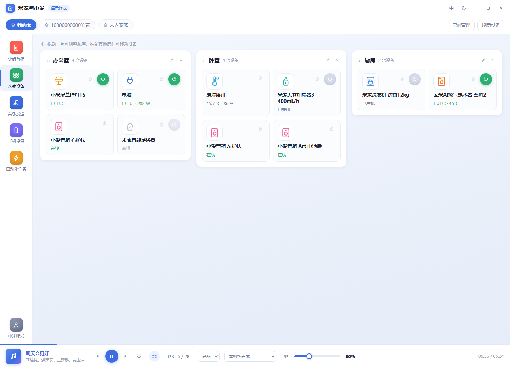
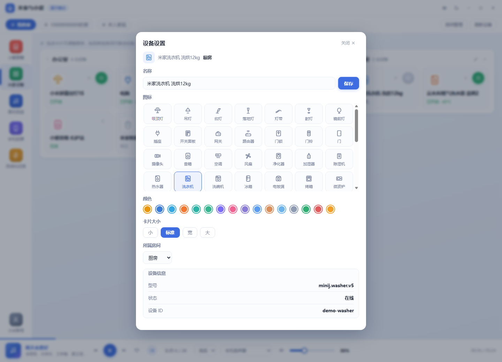
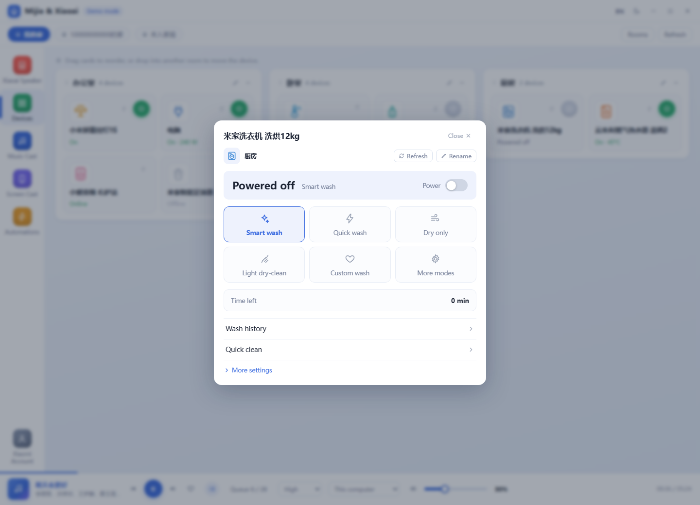
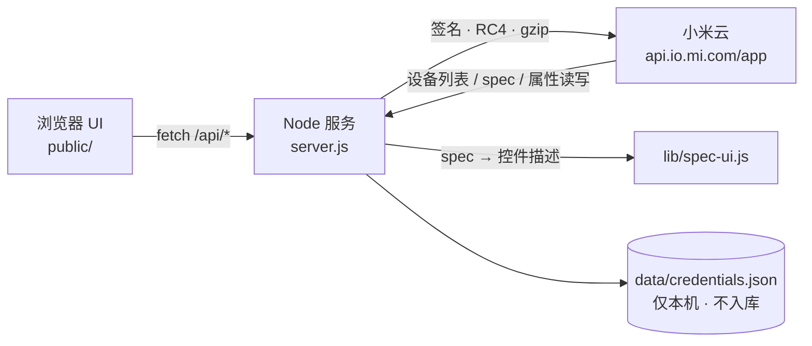

# 米家 Web 版 · Mi Home for the Browser

<div align="center">

**在电脑浏览器里控制家里的小米智能设备** —— 扫码登录真实账号，或直接用内置演示模式体验。

界面参照米家 PC 端（米家与小爱）：家庭标签、房间分组、绿色电源键、底部播放条、设备详情弹窗。


</div>



> 截图取自内置演示模式，设备与房间均为虚构数据。

---

## 这是什么

一个**跑在本机的网页版米家**。后端是一个零第三方依赖的 Node 服务，前端是手写 HTML/CSS/JS，
通过小米云 `api.io.mi.com` 的 MIoT 接口读写设备属性，UI 由设备的 **MIoT spec 自动生成**——
新增设备不需要改任何前端代码。

- **演示模式开箱即用**：不登录也能完整体验（模拟温湿度漂移、洗衣机倒计时、播放进度）。
- **真实设备可控制**：手机米家 App 扫码，即可拉取账号下的设备并下发开关 / 亮度 / 模式 / 动作。
- **凭据只留在本机**：写在 `data/credentials.json`，不进仓库、不上传任何服务器。

---

## 功能

| 分类 | 能力 |
|---|---|
| **设备** | 房间分组列表、在线状态、卡片一键开关、详情弹窗、设备改名 |
| **通用控件** | 由 MIoT spec 生成 `switch` / `slider` / `select` / `command` / `action` / 只读状态 |
| **布局** | 卡片拖动排序、拖到别的房间即移动、尺寸 小/标准/宽/大、房间拖动排序与折叠、≥7 台设备的房间自动横跨两列 |
| **外观** | 57 个设备图标 + 16 种颜色，按设备持久化；深色模式 |
| **多语言** | 中 / EN 一键切换（`?lang=en`），含控件名、枚举值、状态行、toast 提示 |
| **小爱音箱** | 音量 / 播放控制 / 蓝牙 Mesh / 蓝牙音频 / DTS 音效 / 组合立体声 |
| **音乐** | 播放条、播放队列、随机、音质、输出设备切换、音乐投送 |
| **其他** | 自动化场景（演示）、房间管理、深链接（`?did=` `?settings=` `?view=` `?theme=`） |

<details>
<summary><b>不做的事（有意为之）</b></summary>

- 添加/删除设备、消息推送、任意场景触发 —— 与参考项目口径一致，只做"看看和控制"。
- 云端房间管理、云端场景、定时 —— 接口未接入，界面里的相关功能仅演示模式生效。

</details>

---

## 快速开始

需要 Node.js 18+（用到内置 `fetch` 与 `node:test` 之外的现代 API）。

```bash
git clone https://github.com/ClaudiaXcf/NewMijiaHub.git
cd NewMijiaHub
node server.js
```

打开 <http://127.0.0.1:8899/> —— 直接就是演示模式。

**接自己的设备**：侧栏「小米账号」→「扫码登录」→ 手机米家 App 扫一扫确认。
登录后设备/房间/属性全部来自真实账号，凭据写入 `data/credentials.json`（权限 `600`）。

> 也可以直接双击 `public/index.html` 用 `file://` 打开：纯静态演示，没有登录入口。

常用启动参数（均为环境变量）：

```bash
PORT=9000 HOST=127.0.0.1 node server.js   # 换端口 / 换监听地址
```

---

## 界面预览

| 设备设置（改名 / 图标 / 颜色 / 尺寸 / 房间） | 英文界面 · 设备详情 |
|---|---|
|  |  |

---

## 工作原理



1. **登录**：`longPolling/loginUrl?sid=xiaomiio` 取二维码，长轮询等确认，再用 serviceToken 换
   passToken；重启时用 passToken 自动续期。
2. **取设备**：`/v2/home/device_list_page` + `/v2/homeroom/gethome_merged` 拿到设备与房间，
   `/appgateway/gspec/Gspec/get_instances_by_dids` 批量取每台设备的 MIoT spec。
3. **生成界面**：spec 的 `services → properties / actions` 被翻译成控件描述（类型、范围、枚举、
   单位、是否可写），前端只认这套描述。
4. **下发**：`/miotspec/prop/set` 写入后**读回校验**（部分设备异步执行，接口先回 `code:1`），
   `/miotspec/action` 执行动作。

### 安全设计

| 措施 | 说明 |
|---|---|
| 默认只监听 `127.0.0.1` | 不显式设 `HOST=0.0.0.0` 就不会暴露到局域网 |
| 凭据落盘 `600` | `data/credentials.json` 原子写入（临时文件 + rename） |
| 凭据不进版本库 | `.gitignore` 排除 `data/*`，`.dockerignore` 排除整个 `data` |
| 退出登录只删本机 | 不动手机端，也不动云端 |

⚠️ **本项目自身没有登录鉴权**：谁访问到这个端口，谁就能控制这些设备。
**不要直接把它暴露到公网**，详见 [部署文档的安全清单](DEPLOY.md#安全清单)。

---

## MIoT 协议实测记录

下面这些都是在真实账号上踩出来的，不是从文档抄的。做同类项目的人可以直接省掉这些时间：

| 事实 | 现象与处理 |
|---|---|
| `gspec/get_instances_by_dids` **单次最多 50 个 did** | 超过会返回 `Invalid param (code -8)`。现按 20 台分片串行请求再合并 |
| `instances[did].instance` 是**字符串化的 JSON** | 必须先 `JSON.parse` 才有 `services`；当成对象取会全部丢掉，表现为「设备都在，但一个控件都没有」 |
| 属性 URN 形如 `urn:miot-spec-v2:property:on:00000006:vendor:1` | 取短名要取**类型字段**（`on`），不是最后一段（那是 spec 版本号），否则属性名全变数字 |
| `siid=1` 是 device-information，`siid≥5` 多为厂商私有 | 前者过滤；后者若无中文名映射也不展示，否则界面会冒出 `key-mode`、`colortemperature-add` |
| `xxx-add` / `xxx-dec` 是**增量**属性 | 不能做成滑杆：连续拖动会不停累加下发，灯会乱跳。已排除 |
| 多路开关是多个 `service:switch` | 按 service description 的序数命名（第一路 / 第二路），状态行显示 `2/4 开启`；**siid 不一定连续**（见过 14/15/16） |
| `prop/set` **返回 `code:1` ≠ 失败** | 部分设备异步执行：接口 200ms 就回 `code:1`（已下发未确认），**约 0.7s 后属性才真正变化**。只看返回码会把成功判成失败。现统一「写后读回验证」（轮询 2.6s） |
| 只写枚举属性是**瞬时命令** | 只有 `write` 权限、没有状态可读（如"背部升起 / 停止 / 保存记忆"）。做成下拉会残留假值，现归为 `command`：一次性按钮 + 服务端跳过读回验证 |
| `service:custom` 的属性 `description` 可能为空 | 只能靠属性短名映射中文；没映射就会被"无语义字段"规则整批过滤，表现为"点进去没东西可操作" |
| **网关没有"开关机"概念** | 中枢网关 spec 里唯一的布尔写属性是 `service:indicator-light` 的 `on`（指示灯）。拿它当电源会显示「已关闭」，与事实相反。现按 `:device:gateway:` 类型固定显示「运行中 · IP」 |
| 指示灯 / 夜灯 / 背光开关是**附属开关** | 可单独控制，但不计入卡片电源状态和「N/M 开启」统计 |
| 面板的 `vd-*` 服务是**虚拟子设备占位** | 展开会得到一堆同名「电源」，已过滤 |
| 同一设备内会出现**同名控件** | 一个风扇灯有 `light`/`fan`/`ambient-light` 三个服务各带「模式」「电源」。现用服务中文名做前缀消歧（风扇模式 / 氛围灯电源） |
| 灯组 did 是 `group.` 前缀 | 不是纯数字；读接口正常返回 `code:0`，写走同一套 MIoT 接口 |
| `prop/get` 点数不宜过几百 | 现按 100 点/批、最多 3 并发 |

> 还有一个经典 JS 坑：`rank = { switch: 0, ... }` 用 `rank[t] || 9` 兜底，
> `0` 是 falsy 会被判成 9，结果电源开关全被排到末尾又被 `slice(0, N)` 截掉。
> 现统一 `rank[t] != null ? rank[t] : 9`。

---

## 目录结构

```
server.js                零依赖 Node 服务：静态托管 + API + 凭据管理 + 写入校验
lib/
  xiaomi-sign.js         nonce / sessionSecurity / SHA1 签名 / RC4(1024 burn) / 响应解密
  xiaomi-auth.js         扫码登录：loginUrl → 长轮询 → serviceToken 兑换 → passToken 续期
  xiaomi-cloud.js        云 RPC：device_list / prop get|set / action / spec / rename
  spec-ui.js             MIoT spec → 前端控件描述（本项目最核心的一层）
public/
  index.html             单页外壳
  css/style.css          全部样式（含深色主题变量）
  js/icons.js            内联 SVG 图标集（80+，其中 57 个可选作设备图标）
  js/i18n.js             中英词典 + 正则规则 + DOM 兜底翻译
  js/demo-data.js        演示数据（与云端设备模型同构）
  js/api.js              API 层（演示 / 云端自动切换）
  js/app.js              视图渲染 + 交互 + 模拟引擎 + 布局持久化
test/
  browser-smoke.js       前端逻辑冒烟测试（DOM 桩，node 直接跑）
  ui-click.js            真实浏览器交互测试（Edge/Chrome headless + CDP）
  shot.js                截图工具
docs/                    README 用截图
data/                    凭据目录（仅 .gitkeep 入库）
```

## 测试

```bash
node test/browser-smoke.js   # 22 项断言：渲染、电源、模式切换、场景、弹窗
node test/ui-click.js        # 21 项真实浏览器断言：点击、拖拽排序、图标、中英切换、0 报错
node test/shot.js docs       # 需要服务已启动；截 4 张图到 docs/
```

`ui-click.js` 会拉起无头 Edge（或 Chrome），通过 CDP 真实点击与拖拽，
而不只是比对 DOM 字符串 —— 拖动这类交互光靠 DOM 桩是测不出来的。

> 布局状态（顺序、尺寸、图标、颜色、房间覆盖、折叠、语言）存在 localStorage
> 的 `layout` / `lang` 字段里，换浏览器或清缓存会回到默认布局。

---

## 部署

本地、systemd、pm2、Docker、Nginx 反向代理 + HTTPS、安全清单、排错 —— 都在
**[DEPLOY.md](DEPLOY.md)**。

最省事的容器方式：

```bash
docker compose up -d --build     # 只监听 127.0.0.1:8899，凭据挂载到 ./data
```

---

## 已知限制

1. 部分厂商私有属性没有中文描述，控件名仍是英文（实测约占 17%），功能不受影响。
2. 设备列表只请求一页（`limit=200`），设备特别多时需要分页。
3. spec 缓存 10 分钟（按 did 集合做 key）；新增设备后想立刻看到控件可重启服务。
4. 云端房间管理 / 场景 / 定时未接入，相关界面仅演示模式生效。
5. 扫码登录是逆向接口，小米随时可能改动；失效时以演示模式仍可正常使用。

## 路线图

- [ ] 设备分页 + 增量刷新
- [ ] 云端房间管理（homeroom 接口）
- [ ] 场景 / 定时执行
- [ ] 属性订阅（长连接推送）替代轮询

---

## 致谢与免责声明

- 协议细节来自 [shallow-seek-nothing/mihome-pc-unofficial](https://github.com/shallow-seek-nothing/mihome-pc-unofficial)
  的公开逆向文档。本项目是**独立重写**的 Node/JS 实现，未复制其代码（该项目为 PolyForm Noncommercial 许可）。
- 与小米公司无关。「米家」「小爱」等商标归其权利人所有，请仅用于**控制自己的设备**。
- 逆向接口属于非官方用法，可能因服务端调整而失效；由此产生的风险请自行评估。
- 本仓库未附带开源许可证，如需二次分发请先联系作者。
